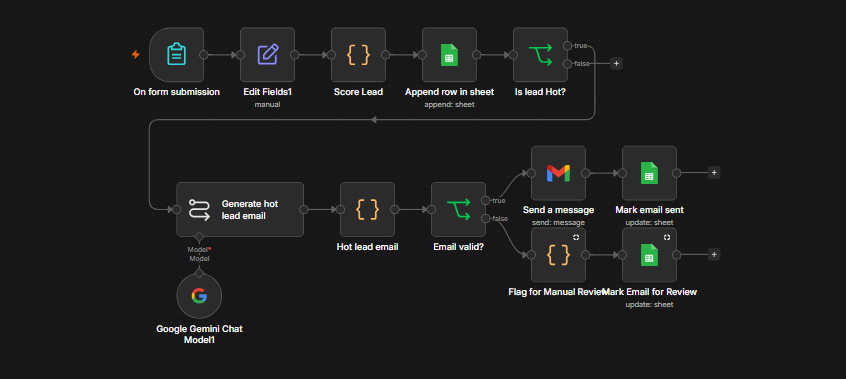
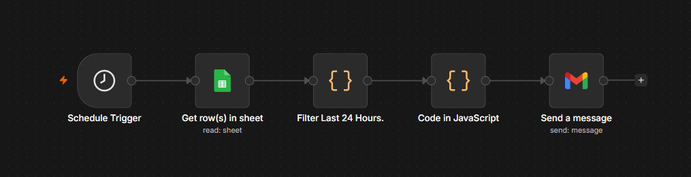
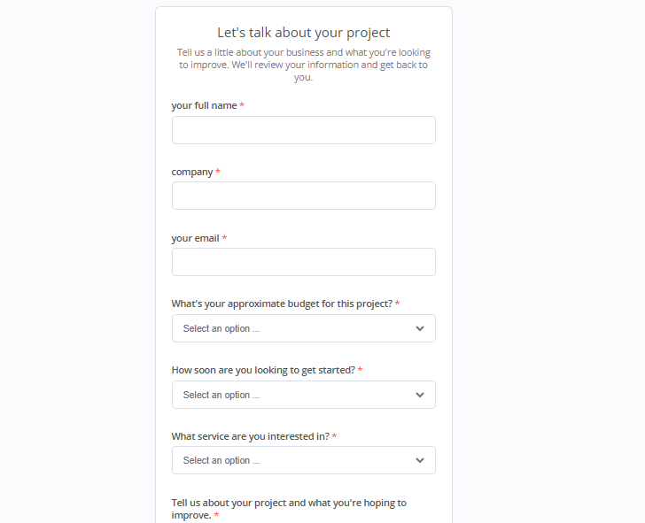
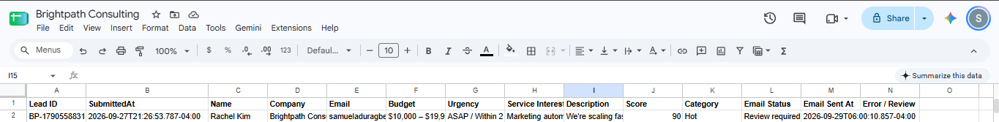

# Brightpath Lead Management

## Keep new enquiries organised and make it easier to follow up.

Brightpath is a portfolio project built around a common business problem: new enquiries come in, but it can be difficult to collect the details, decide which ones need attention first, and make sure nobody gets forgotten.

It brings lead intake, prioritisation, follow-up, and a daily lead report into one process.

## Contents

- [Project overview](#project-overview)
- [Tools needed](#tools-needed)
- [What it does](#what-it-does)
  - [New enquiry handling](#1-new-enquiry-handling)
  - [Daily lead summary](#2-daily-lead-summary)
- [Why this is useful](#why-this-is-useful)
- [Screenshots](#screenshots)
  - [New enquiry workflow](#1-new-enquiry-workflow)
  - [Daily summary workflow](#2-daily-summary-workflow)
  - [Enquiry form](#3-enquiry-form)
  - [Lead tracking sheet](#4-lead-tracking-sheet)
  - [Follow-up email](#5-follow-up-email)
  - [Daily summary email](#6-daily-summary-email)
- [Project notes](#project-notes)
- [Files in this repository](#files-in-this-repository)
- [Get in touch](#get-in-touch)

## Project overview

The project has two connected workflows. The first handles new enquiries and prepares follow-up for high-priority leads. The second sends a daily email summary of the leads received in the previous 24 hours.

This is a portfolio demonstration based on a business scenario, not a live client deployment.

## Tools needed

These are the services used in the workflows:

- **n8n** for running the workflows.
- **Google Sheets** for storing and reviewing lead information.
- **Google Gemini** for helping prepare follow-up messages for high-priority enquiries.
- **Gmail** for sending follow-up messages and the daily summary.

You will need your own accounts and connections for these services before activating the workflows.

## What it does

There are two connected parts to this project.

### 1. New enquiry handling

When someone submits the enquiry form, the workflow:

- Collects their contact details and what they are looking for.
- Looks at the budget and how soon they want to get started.
- Gives the enquiry a score and marks it Hot, Warm, or Cold.
- Saves the details in a lead tracking sheet.
- Prepares a more personal follow-up for high-priority enquiries.
- Checks the message before sending it. If it does not pass the checks, it is held for a person to review.

The idea is simple: your team should not have to treat every enquiry as if it has the same level of urgency.

### 2. Daily lead summary

The second workflow runs every morning at 8:00. It checks the lead sheet and looks at enquiries received in the previous 24 hours.

It then puts together a report showing:

- How many new enquiries came in.
- How many were marked Hot, Warm, and Cold.
- The details of each lead, including the company, budget, service interest, urgency, and score.

The report is sent by email, so the business owner or sales team can see what came in without going through every row in the sheet.

## Why this is useful

A new enquiry is only useful if someone notices it and follows up.

This setup gives a business a clearer way to see which prospects may need attention, keep their details in one place, and start each day with a quick picture of recent enquiries.

It does not make sales decisions for your team. It helps your team see what is happening and decide what to do next.

## Screenshots

These spaces are here for screenshots from the actual project. The notes explain exactly what to capture.

### 1. New enquiry workflow

<!-- Add screenshot: images/01-enquiry-workflow.png -->

### 2. Daily summary workflow

<!-- Add screenshot: images/02-daily-summary-workflow.png -->

### 3. Enquiry form

<!-- Add screenshot: images/03-enquiry-form.png -->

### 4. Lead tracking sheet

<!-- Add screenshot: images/04-lead-tracking-sheet.png -->

### 5. Follow-up email

<!-- Add screenshot: images/05-follow-up-email.png -->

*Capture an example of the follow-up prepared for a Hot lead. Use a fictional prospect and hide all private inbox details. Show the message itself, not your account settings.*

### 6. Daily summary email

<!-- Add screenshot: images/06-daily-summary-email.png -->

*Capture the daily report email showing the total number of leads and the Hot, Warm, and Cold sections. Use fictional sample data and hide the recipient address and any private information.*

## Project notes

Both workflow exports are included in this repository. They are intentionally inactive. The public copies have been cleaned of credential references and private account details. The spreadsheet ID and email recipient are placeholders, so the workflows need to be connected to the business's own accounts and tested before use.

The daily report is scheduled for 8:00 according to the timezone configured in the n8n environment. It uses a rolling 24-hour window, not a calendar-day report.

The lead-intake workflow still needs its Hot-lead routing condition corrected before it is ready to run. It is included here to show the intended workflow design, not as a ready-to-import-and-activate setup.

## Files in this repository

- `brightpath-lead-intake-scoring.json`: collects and prioritises new enquiries, records them, and prepares a follow-up.
- `brightpath-daily-lead-summary.json`: checks the previous 24 hours of enquiries and emails a daily report.

## Get in touch

If enquiries are coming in but your team is finding it hard to keep track of them, decide who to contact first, or follow up consistently, I can help map out a process that fits your business.

The first thing I would want to understand is how enquiries reach you today and where they tend to get missed.
